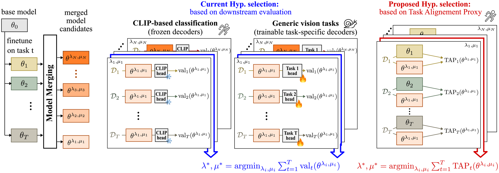

<div align="center">
<h1>Task Alignment: A Simple Proxy for Practical Model Merging Across Diverse Vision Tasks</h1>

**Pau de Jorge**, **César Roberto de Souza**, **Björn Michele**, **Mert Bülent Sarıyıldız**, **Philippe Weinzaepfel**, **Florent Perronnin**, **Diane Larlus**, **Yannis Kalantidis**

NAVER LABS Europe

**ECCV 2026**

[[Paper](https://arxiv.org/abs/2604.12935)] · [[Citation](#citation)]
</div>

## Contents

- [About Task Alignment](#about-task-alignment)
- [Installation](#installation)
- [Computing Task Alignment](#computing-task-alignment)
- [Model merging evaluation](#model-merging-evaluation)
- [Reproducing the main experiments](#reproducing-the-main-experiments)
- [Results on the CLIP benchmark](#results-on-the-clip-benchmark)
- [Logging](#logging-optional)
- [Citation](#citation)
- [Acknowledgements](#acknowledgements)

---

## About Task Alignment

Efficiently merging several models fine-tuned for different tasks, but stemming from the same pretrained base model, is of great practical interest. Despite extensive prior work, most evaluations of model merging in computer vision are restricted to image classification using CLIP, where different classification datasets define different tasks. In this work, our goal is to make model merging more practical and show its relevance on challenging scenarios beyond this specific setting. In most vision scenarios, different tasks rely on trainable and usually heterogeneous decoders. Differently from previous studies with frozen decoders, where merged models can be evaluated right away, the non-trivial cost of decoder training renders hyperparameter selection based on downstream performance impractical. To address this, we introduce the **task alignment proxy**, and show how it can be used to speed up hyperparameter selection by orders of magnitude while retaining performance. Equipped with the task alignment proxy, we extend the applicability of model merging to multi-task vision models beyond CLIP-based classification.

<p align="center">
  
</p>
<p align="center"><em>Hyperparameter selection for model merging. Merging a set of fine-tuned experts yields one candidate model per hyperparameter setting (λ, μ). Current practice scores each candidate by downstream validation accuracy — cheap for CLIP-based classification, where decoders are frozen, but prohibitively slow for generic vision tasks, where every candidate needs its own trained task-specific decoder. We instead score candidates with the <strong>Task Alignment Proxy (TAP)</strong>, comparing the merged encoder's features against each task's fine-tuned expert on a small batch of data, and pick the setting that minimises it — no decoder training required.</em></p>

### How it works

For each task, we extract features from the merged model and from that task's fine-tuned expert, and compare them with a distance metric (l2 norm by default). Averaging across tasks gives the **Task Alignment Proxy (TAP)**, which is used to select merging hyperparameters in place of downstream accuracy.

The key practical properties are that TAP needs **no decoder, no labels, and no training** — only forward passes through the merged and fine-tuned encoders.

## About this repository
This repository contains the **CLIP-benchmark experiments** reported in the paper. Namely, we compute TAP for several merging methods and report both the TAP score and the validation eval for each hyperparameter in the results files. From there, we compare the test performance of the best performing hyperparameters on the evaluation setting vs. the best settings according to TAP. That would be the corresponding numbers in Table 1 and Table 11 (in appendix). See also the [results section](#results) in this README for further details. 

## Installation

This code is **based on the [Task Singular Vectors (TSV)](https://github.com/AntoAndGar/task_singular_vectors) repository** by Gargiulo *et al.* (CVPR 2025) and **the environment, checkpoints, and datasets are exactly the same as in the TSV repository.** Please refer to the original TSV repo for installation instructions.

This repository covers **merging and evaluation only**. It does not fine-tune: all experiments start from the fine-tuned checkpoints published with TSV, so obtaining those checkpoints is a prerequisite rather than something this code reproduces.

The code uses configs to organize experiments, please modify `model_location` and `data_location` in `config/config.yaml` before evaluation.

## Computing Task Alignment

Task alignment is computed alongside the standard merging evaluation whenever `compute_tas=True` (the default in `config/config.yaml`). For every task, we build a proxy dataloader, extract features from the merged model and from that task's fine-tuned expert, and compare them with `get_tas` in `src/utils/tas_utils.py`. The relevant options are:

- `compute_tas` — enable/disable task-alignment computation.
- `tas_metric` — distance used to compare merged vs. fine-tuned features (`l2`, `l1`, or `cosine`). Default used in the paper is l2.
- `proxy_dataset_mode` — which proxy data to use per task: `per_task` (each task uses its own validation set; used in the paper experiments) or `shared` (all tasks use a common proxy, `proxy_shared_dataset`; not used in the paper experiments.).
- `tas_batch_size` — batch size of the proxy dataloader.
- `num_batches_tas` — number of proxy batches to use (`-1` uses all proxy data). We observed a single batch (i.e. `1`) is actually enough, as TAP is very robust to number of images.
- `tas_seed` — seed for sampling the proxy batches.
- `skip_tas` / `skip_eval` — skip the task-alignment computation or the accuracy evaluation respectively (useful when you only want one of the two).

> **Note on naming — TAS is TAP.** The proxy was called the *Task Alignment Score* (**TAS**) while this code was written, and was renamed to the *Task Alignment Proxy* (**TAP**) for the paper. The two names refer to exactly the same quantity. The code kept the original spelling, so throughout this repository you will see `tas` in config options (`compute_tas`, `tas_metric`, `tas_batch_size`, `num_batches_tas`, `tas_seed`, `skip_tas`), in file and function names (`src/utils/tas_utils.py`, `get_tas`), in result filenames (`tasseed=`, `tasbs=`, `tasnb=`, `tasmetric=`) and in some console output. Read all of these as TAP.


## Model merging evaluation

The command below run a single merging + task-alignment evaluation. Set `compute_tas=True` to additionally report the Task Alignment Proxy.

##### Evaluate with baseline model merging methods:
```bash
# Evaluate with Task Arithmetic (and compute task alignment)
python main.py model=ViT-B-32 method="sum" compute_tas=True

# Evaluate with weight averaging
python main.py model=ViT-B-32 method="average" compute_tas=True
```

##### Evaluate model merging with TSV + baseline model merging methods:
```bash
# Evaluate with TSV-Merge Orthogonalization
python main.py model=ViT-B-32 method="TSVM" compute_tas=True

# Evaluate with TSV-Merge Eigendecomposition
python main.py model=ViT-B-32 method="TSVM_2" compute_tas=True

# Evaluate with Tall mask + Task Arithmetic (load tall masks from storage)
python main.py model=ViT-B-32 method="tall_mask" method.load_mask=True
```

##### Evaluate for compression methods:
``` bash
# Evaluate with TSV-Compress
python main.py model=ViT-B-32 method="TSVC"

# Evaluate with Consensus Task Arithmetic (after constructing TALL masks)
python main.py model=ViT-B-32 method="consensus" method.prun_thre_k=2
```

Note that you can set different numbers of tasks by setting `num_tasks`. Then, the first `num_tasks` will be selected from the list defined in `src/utils/variables_and_paths.py`. Alternatively, you can directly specify the tasks as a list of strings (e.g. `DATASETS=["MNIST","Cars"]`). The results can be retrieved by setting `num_tasks` to 8, 14 and 20 for the corresponding experiments.

## Reproducing the main experiments

The **main results come from the launch scripts at the top level of the repository**. Each script sweeps over models, number of tasks, merging methods, and task-alignment settings, and prints one ready-to-run command per line to stdout. Pipe them to your shell (or your job scheduler) to run them, e.g.:

```bash
# Print the commands
python launch_exps.py

# ...or run them directly
python launch_exps.py | bash
```

The available launch scripts are:

- `launch_exps.py` — main merging + task-alignment experiments across models (`ViT-B-32`, `ViT-B-16`, `ViT-L-14`), task counts (8, 14, 20), and merging methods (`sum`, `average`, `TSVM`, `ties`, `consensus`, `STAR`, `iso_cts`, `iso_c`, ...). Uncomment the methods/models you want to run.
- `launch_tas_dist_ablation.py` — ablation over the task-alignment distance (`tas_metric` ∈ {`l1`, `l2`, `cosine`}) across seeds.
- `launch_bs_ablation.py` — ablation over the proxy batch size used to compute task alignment (`tas_batch_size`) across seeds.
- `launch_ada_tas_ablations.py` — AdaMerging / TAP-guided merging (`adamerging_*`, `tasmerging_*`) experiments.

Results are written to the `results/` folder. The plotting and table scripts at the top level (`plot_*.py`, `table_*.py`) turn those JSON files into the figures and tables reported in the paper.

## Results on the CLIP benchmark <a id='results'></a>

**Hyperparameter search vs. TAP selection.** Test accuracy of the merged models when merging hyperparameters are chosen by exhaustive search on the labelled validation set (`w/ val`) versus by the Task Alignment Proxy (`w/ TAP`). For each merging method, the better of the two is in **bold**. Despite using no labels and only a fraction of the validation images, the drop from TAP selection is minimal. For AdaMerging we instead compare optimising TAP against optimising entropy, where TAP appears more robust as the number of classes grows.

Numbers are average test top-1 accuracy (%) over the `T` merged tasks. `T=8`, `14` and `20` use the first 8, 14 and 20 datasets from the list in `src/utils/variables_and_paths.py`.

| Method | ViT-B-32<br>T=8 | ViT-B-32<br>T=14 | ViT-B-32<br>T=20 | ViT-B-16<br>T=8 | ViT-B-16<br>T=14 | ViT-B-16<br>T=20 | ViT-L-14<br>T=8 | ViT-L-14<br>T=14 | ViT-L-14<br>T=20 | Average |
|:---|---:|---:|---:|---:|---:|---:|---:|---:|---:|---:|
| TA<sub>w/ val</sub> | **71.14** | **65.19** | **62.61** | **76.18** | **70.44** | **68.19** | **84.90** | 79.41 | **76.01** | **72.68** |
| TA<sub>w/ TAP</sub> | 71.13 | 65.02 | 62.07 | 75.25 | **70.44** | **68.19** | **84.90** | **79.69** | **76.01** | 72.52 |
| TIES<sub>w/ val</sub> | **74.76** | **67.80** | **64.75** | **79.82** | **73.08** | **70.02** | 86.87 | **80.17** | **77.09** | **74.93** |
| TIES<sub>w/ TAP</sub> | 74.50 | **67.80** | **64.75** | **79.82** | **73.08** | **70.02** | **87.02** | **80.17** | **77.09** | 74.92 |
| TSV<sub>w/ val</sub> | **85.77** | **80.03** | **76.93** | **89.01** | 84.28 | **80.65** | **93.00** | **89.20** | 87.52 | **85.15** |
| TSV<sub>w/ TAP</sub> | 85.50 | **80.03** | 76.88 | **89.01** | **84.52** | 80.45 | 92.99 | 89.12 | **87.55** | 85.12 |
| STAR<sub>w/ val</sub> | **71.39** | **65.42** | 62.94 | **76.32** | **70.70** | **68.49** | **84.86** | **79.73** | **76.08** | **72.88** |
| STAR<sub>w/ TAP</sub> | 70.90 | 65.34 | **62.98** | 76.17 | 70.63 | 68.44 | **84.86** | **79.73** | **76.08** | 72.79 |
| Consensus<sub>w/ val</sub> | **74.91** | **70.33** | **66.94** | **79.30** | **74.33** | **71.76** | **86.33** | **82.31** | **79.63** | **76.20** |
| Consensus<sub>w/ TAP</sub> | 74.69 | 70.32 | **66.94** | **79.30** | **74.33** | **71.76** | **86.33** | **82.31** | **79.63** | 76.18 |
| Iso-CTS<sub>w/ val</sub> | **86.48** | **81.56** | **78.17** | **91.16** | **86.29** | **82.81** | **94.81** | **91.02** | **90.19** | **86.94** |
| Iso-CTS<sub>w/ TAP</sub> | 85.77 | **81.56** | 78.08 | 91.03 | **86.29** | 82.57 | 94.72 | **91.02** | **90.19** | 86.80 |
| AdaMerging<sub>w/ Entropy</sub> | **84.15** | 74.97 | 71.49 | **84.39** | 77.43 | 74.96 | 91.42 | 87.02 | 84.34 | 81.13 |
| AdaMerging<sub>w/ TAP</sub> | 80.72 | **75.36** | **72.35** | 83.12 | **78.88** | **76.36** | **91.73** | **87.68** | **87.05** | **81.47** |


### Reproducing the table

Each row corresponds to the following `method=` value, as launched by `launch_exps.py` (merging methods) and `launch_ada_tas_ablations.py` (AdaMerging). Every merging method additionally sweeps the merging coefficient over `n_eval_points` values (21 by default); the method-specific hyperparameters swept on top of that are listed below.

| Paper row | `method=` | Method-specific sweep |
|:---|:---|:---|
| TA | `sum` | — |
| TIES | `ties` | `method.k` ∈ {20, 40, 80} |
| TSV | `TSVM` | — |
| STAR | `STAR` | `method.eta` ∈ {0.2, 0.4, 0.6, 0.8, 0.9, 0.95} |
| Consensus | `consensus` | — (`method.prun_thre_k=2`) |
| Iso-CTS | `iso_cts` | — |
| AdaMerging<sub>w/ TAP</sub> | `tasmerging_task` / `tasmerging_layer` | coefficients optimised, not searched |
| AdaMerging<sub>w/ Entropy</sub> | `adamerging_task` / `adamerging_layer` | coefficients optimised, not searched |

The two AdaMerging variants share the same optimisation loop and differ only in the objective: `adamerging_*` minimises the softmax entropy of the merged model's predictions, while `tasmerging_*` minimises TAP (see `optimize_adamerging` and `optimize_tasmerging` in `src/utils/adamerging.py`).

The `w/ TAP` numbers come from the same runs as `w/ val` — with `compute_tas=True`, both the exhaustive validation search and the TAP-based selection are recorded in the same result JSON, so no separate run is needed.

## Logging (optional)

Results are always written as JSON to `results/` and to the Hydra run directory under `logs/`. Weights & Biases logging is **optional and disabled by default** — `wandb` is only imported if you turn it on, so the code runs fine without it installed. To enable it, `pip install wandb`, run `wandb login`, then:

```bash
python main.py model=ViT-B-32 method="sum" wandb.enabled=true wandb.project=my-project
```

The remaining options live under the `wandb:` section of `config/config.yaml` (`project`, `entity`, `group`, `mode`, `dir`).

## Citation

If you use this code, please consider citing:
```bibtex
@inproceedings{dejorge2026taskalignment,
  title     = {Task Alignment: A Simple Proxy for Practical Model Merging Across Diverse Vision Tasks},
  author    = {de Jorge, Pau and de Souza, C{\'e}sar Roberto and Michele, Bj{\"o}rn and Sar{\i}y{\i}ld{\i}z, Mert B{\"u}lent and Weinzaepfel, Philippe and Perronnin, Florent and Larlus, Diane and Kalantidis, Yannis},
  booktitle = {Proceedings of the European Conference on Computer Vision (ECCV)},
  year      = {2026}
}
```

## Acknowledgements

Code adapted from:
- [Task Singular Vectors](https://github.com/AntoAndGar/task_singular_vectors)
